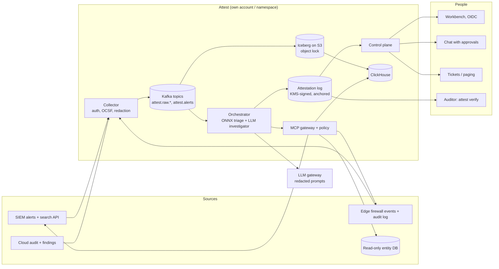

# 16 — Production Readiness Plan (single organization)

**Product:** Attest
**Document type:** Plan. What it takes to run Attest in production for one organization, on top
of an existing SIEM and edge. Tasks live in `TASKS.md`; each section below names its tasks.

> **Plan document.** For what is implemented today, see the Status table in the root README.

---

## 1. Target

A security team already runs a SIEM (Graylog in the reference deployment), an edge/WAF
(Cloudflare) and a cloud provider (AWS). Attest sits beside them:

- The SIEM keeps detecting at first. Attest receives its alerts and edge security events,
  enriches them, triages them with the classifier or the LLM investigator, and signs every verdict.
- Analysts work one queue. Every verdict, label and approval is replayable by an auditor with
  `attest verify`, offline.
- Response actions are proposed and recorded, and executed only after a named person approves.
- Later, Attest runs its own HELIQL detections and keeps 12 months of normalized events for hunting
  and audit retention.

Rollout is **shadow first**: verdicts are produced and measured against analyst decisions for a
few weeks before anyone relies on them.

## 2. Ground rules for this repo

- Organization-neutral. Deployers keep their configuration in a private overlay repo
  (mappings, policies, rules, Helm values, Terraform variables). See §8. Tasks: T-001, T-005.
- Tests gate progress (as in `10_Build_Order.md`). The agent workflow is defined in `AGENTS.md`.

## 3. Architecture



Kafka, ClickHouse, object storage and the LLM gateway can be the organization's existing
services. Attest needs topics, a read-only ClickHouse user, buckets and an OpenAI-compatible
endpoint, not its own copies.

## 4. Sources and context

### 4.1 Source plugin interface — T-020
The collector moves from CloudTrail-only to a `Source` trait (id, decode, normalize). Each source
writes to `attest.raw.<id>`; sources that are already alerts also write to `attest.alerts`.

### 4.2 SIEM (Graylog) — T-021, T-022
- Alerts arrive as HTTP notifications, HMAC-signed, mapped to OCSF Detection Finding (2004).
- The investigator searches the SIEM through a bounded, read-only `graylog_search` tool.
- A **detection heartbeat** compares each event definition's last run with its schedule.
  A definition that silently stops running is itself an alert.

### 4.3 Edge and cloud — T-023, T-027
- Edge firewall events from Logpush to object storage → OCSF HTTP Activity (4002).
- Edge audit log → OCSF API Activity (6003). Config changes to security tooling are a detection.
- Cloud findings (GuardDuty) → Detection Finding.

### 4.4 Local object storage — T-002
Local dev and CI use a maintained S3-compatible store. Production uses the cloud's object store.

### 4.5 Field mapping and redaction — T-024
Deployer fields map through config to OCSF paths or to `unmapped.<prefix>.*`. Personal data
(email, phone, card-like numbers) is hashed or dropped in the collector, before the bus.

### 4.6 Enrichment — T-025, T-026
Stub tools are replaced: offline IP/ASN database, open threat-intel feeds with sync time, real
baselines, and an `entity_lookup` tool that runs only named, parameterized query templates against a
read-only database.

## 5. Trust hardening

| # | Control | Tasks |
| --- | --- | --- |
| 5.1 | Service-to-service auth on every non-health route; HMAC + replay window on ingest | T-010 |
| 5.2 | OIDC sign-in with roles (viewer, analyst, lead, auditor); password sign-up off in production | T-011 |
| 5.3 | Pluggable signer with cloud KMS, `key_id` and `alg` in envelopes, keyring verify; chain tip anchored to object-locked storage so truncation is detected | T-012, T-013 |
| 5.4 | Secrets from mounted files or a secrets manager, per tool, rotated without restart | T-014 |
| 5.5 | Prompt-injection regression suite on log fields; policy holds even when the model obeys the injection | T-015 |
| 5.6 | Policy from a reviewed file, do-not-touch list, policy hash in every envelope | T-034 |

Threat model summary:

| Threat | Control |
| --- | --- |
| Injection through log fields | Fields passed as quoted data; policy outside the model; no auto-action in shadow mode |
| Agent privilege escalation | Per-role allow lists; tests per role |
| Bulk exfiltration through hunting | Row, time and rate caps; read-only users |
| Forged alerts | HMAC or mTLS on ingest; private network only |
| Tampered history | Hash chain, KMS signing, anchored tip, daily verify |
| Model swap | Model hash pinned in CI and recorded per envelope |
| Replayed approvals | Unique action IDs, approval expiry |
| Stolen tool token | One scoped token per tool, rotation |
| Data leaving the jurisdiction | Redaction before the bus; LLM only through a gateway the operator controls |

## 6. Triage and operations

- **6.1 Detection pack.** Generic rules shipped here with positive and negative fixtures (T-004):
  brute force, anomalous login geography, OTP request bursts, card-testing patterns, edge bypass
  spikes, path-evasion probes, security-tool config changes, stalled detections. Deployer-specific
  thresholds and lists stay in the overlay.
- **6.2 Labels and retraining** (T-030, T-031). Analysts record agree/disagree. Retraining is
  weekly; the new model's hash is pinned.
- **6.3 Shadow mode** (T-032). Everything is signed, nothing is applied. Agreement metrics per detection.
- **6.4 Outputs** (T-033). Chat with signed approval buttons, tickets, paging, generic webhook.
- **6.5 Evaluation** (T-035). Golden-set evaluation in CI; any missed true positive fails the build.

## 7. Packaging — T-040 to T-043

Helm with external dependencies, default-deny NetworkPolicies, non-root pods and IAM via service
accounts. Terraform for KMS, buckets with Object Lock and roles. A single-organization deployment
guide. Hosted-demo code (waitlist, marketing, Railway) is isolated from the production image.

## 8. Public core, private overlay

```
attest (public, this repo)            org-attest-overlay (private)
├── crates, apps, detections          ├── config/mappings/*.yaml
├── generic rule pack                 ├── config/policy.yaml (+ do-not-touch list)
├── Helm chart, Terraform modules     ├── detections/*.heliql (org rules)
└── docs, skills, TASKS.md            ├── helm/values-prod.yaml
                                      ├── terraform/*.tfvars
                                      └── TASKS.org.md (org-only work)
```

The overlay pins a released Attest version (image tag and chart version). Generic improvements are
built here first, released, then picked up by the overlay. Organization-specific content never
crosses back.

## 9. Go-live gates (per deployment)

| Gate | Evidence |
| --- | --- |
| Hardening complete | M1 tasks done; external pentest of the deployment with highs closed |
| Shadow period | At least 3 weeks; agreement ≥ 90% per enabled detection; 0 missed true positives on the golden set |
| Integrity | `attest verify` with anchors passes daily for the whole shadow period |
| Rollback | Switching SIEM notifications back to the old channel is tested |
